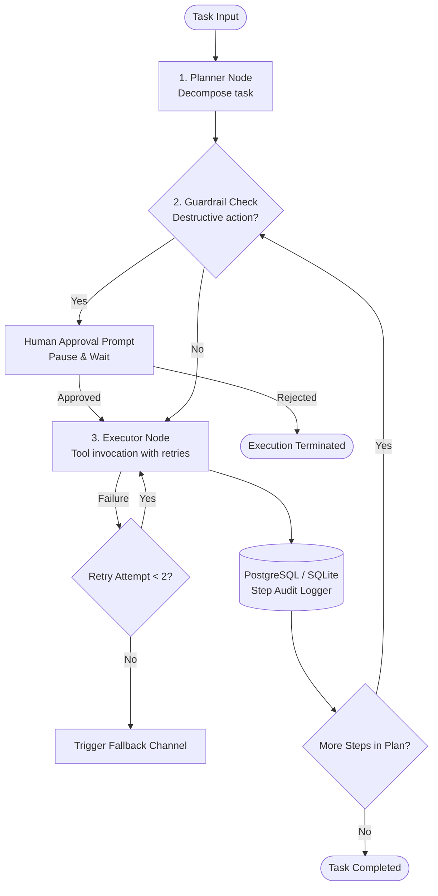

# Tool-Calling Agent with Guardrails (Agentic AI)

A robust, lightweight **Planner-Executor Agent** built with **Python, LangGraph, OpenAI API, and PostgreSQL / SQLite**. Designed to decompose and automate multi-step tasks reliably with tool orchestration, automated retries/fallbacks, guardrails, and human-in-the-loop (HITL) approval for destructive actions.

---

## 📌 Architecture Overview



---

## 🚀 Key Features

- **Planner-Executor in LangGraph**: Decomposes natural language requests into structured tool plans (`fetch_record`, `send_notification`, `delete_record`).
- **Resilience with Retries & Fallbacks**: Recovers from transient network or tool failures with automatic exponential retries and fallback execution channels.
- **Safety Guardrails & Human-in-the-Loop (HITL)**: Automatically detects destructive tools (e.g. `delete_record`, `purge_data`), pauses execution, and prompts for explicit human approval before proceeding.
- **Audit Logging**: Persists every single decision (plans, guardrail intercepts, tool arguments, results, retries) to PostgreSQL (or SQLite local fallback).
- **Evaluation Harness**: Evaluates agent reliability across multi-step benchmarks measuring task completion rate, retry recovery, and guardrail interception.

---

## 📂 Project Structure

```text
├── agent.py          # LangGraph state machine, planner, guardrail, and executor nodes
├── tools.py          # Tool definitions, destructive action rules, retries & fallbacks
├── database.py       # Audit logging with PostgreSQL support & SQLite fallback
├── main.py           # Interactive CLI demonstrating safe tasks and HITL confirmation
├── app.py            # Streamlit visual dashboard with approval buttons and live audit feed
├── evaluate.py       # Reliability evaluation harness across multi-step scenarios
├── test_agent.py     # Unit and integration test suite (pytest)
├── docker-compose.yml# Single-command PostgreSQL setup
├── INTERVIEW_GUIDE.md# Technical interview Q&A and architecture talking points
├── requirements.txt  # Dependencies
└── .env.example      # Environment configuration (OpenAI API key, Database URL)
```

---

## ⚡ Quickstart

### 1. Install Dependencies
```bash
pip install -r requirements.txt
```

*(Note: The agent works 100% out-of-the-box using the built-in deterministic planner and local SQLite audit log. To use live OpenAI GPT-4o-mini or PostgreSQL, copy `.env.example` to `.env` and set your credentials).*

### 2. Run the Demo (CLI or Web UI)
```bash
# Terminal CLI demo:
python main.py

# Or launch the interactive Web Dashboard:
streamlit run app.py
```
This runs two multi-step scenarios:
1. **Safe Multi-Step Task**: Fetches user data, encounters a simulated API failure, and recovers automatically via retries.
2. **Destructive Task**: Detects a deletion tool, triggers safety guardrails, prompts for human confirmation, and logs the entire audit trail to the database.

### 3. Run Reliability Evaluation Benchmark
```bash
python evaluate.py
```
Outputs a reliability benchmark report verifying completion rate, retries recovered, and guardrail enforcement.

### 4. Run Test Suite
```bash
pytest test_agent.py -v
```

